# FlarePoint

**Geospatial Wildfire Intelligence, Satellite Event Tracking & Reproducible Terrain Analysis**


FlarePoint is a satellite-based wildfire detection, incident association, and geospatial intelligence system built around NASA FIRMS thermal observations, spatiotemporal clustering, Copernicus DEM GLO-30 terrain contextualization, and reproducible wildfire validation research.

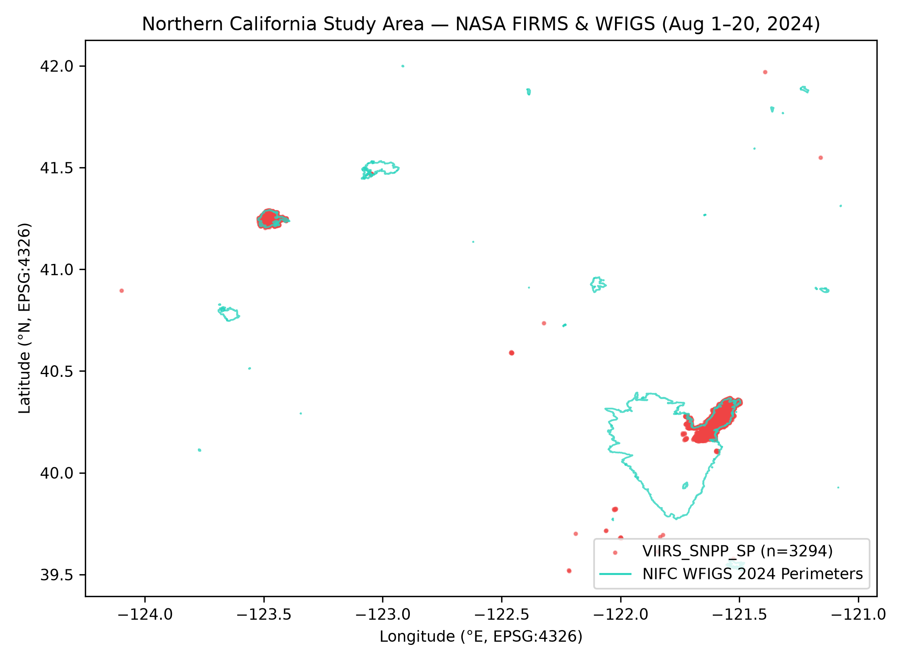

---

## Key Capabilities

- **Satellite Ingestion & Provenance**: NASA FIRMS Area CSV adapter (`VIIRS_SNPP_NRT`, `VIIRS_SNPP_SP`, `VIIRS_NOAA20_NRT`, `MODIS_NRT`) with deterministic `SIMULATED_DEMO` isolation, SHA-256 deduplication, and explicit validation.
- **Spatiotemporal Clustering & Continuity**: Haversine DBSCAN (`eps_km`, `min_samples`) with temporal-gap splitting, 1-to-1 weighted incident association, fragmentation-aware `ContinuityEvent` grouping, and cautious lifecycle semantics (`NEWLY_OBSERVED` → `ACTIVE` → `DORMANT` → `RE_OBSERVED` → `CLOSED`).
- **Terrain-Aware Analysis**: Copernicus DEM GLO-30 retrieval, atomic GeoTIFF caching, local UTM (`pyproj` + `rasterio`) reprojection, Horn 3×3 slope/aspect, Riley TRI, TPI, Laplacian curvature, multi-scale extraction (`250 m`–`3000 m`), and terrain-relative centroid displacement.
- **Operational GIS Workstation**: Dark-themed Next.js + MapLibre GL 2D/3D viewport with hotspot popups, cluster selection, temporal playback, Recharts analytics, and provenance/audit panels.

---

## System Architecture

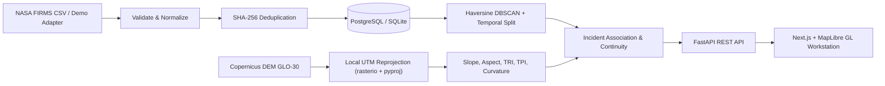

---

## Technology Stack

| Layer | Technologies |
| :--- | :--- |
| **Frontend** | Next.js 15, React 19, TypeScript, Tailwind CSS, MapLibre GL 4.7, Recharts |
| **Backend** | Python 3.12+, FastAPI, Pydantic, SQLAlchemy 2.0, Alembic |
| **Geospatial** | Rasterio, PyProj, Shapely, scikit-learn (Haversine DBSCAN), SciPy, NumPy |
| **Data Sources** | NASA FIRMS (`VIIRS_SNPP_SP/NRT`), Copernicus DEM GLO-30, NIFC WFIGS Perimeters, Open-Meteo |
| **Infrastructure & Tests** | Docker Compose (`postgis/postgis:16-3.4`), `pytest` (25 automated tests) |

---

## Terrain Intelligence (Copernicus DEM GLO-30)

All terrain derivatives are computed in local metric UTM (`EPSG:326xx`/`327xx`) using bilinear resampling at `30 m` resolution. Flat terrain (`grad <= 1e-9`) is masked (`NaN`) rather than assigned an arbitrary aspect.

| Elevation (m) | Horn 3×3 Slope (°) |
| :---: | :---: |
| 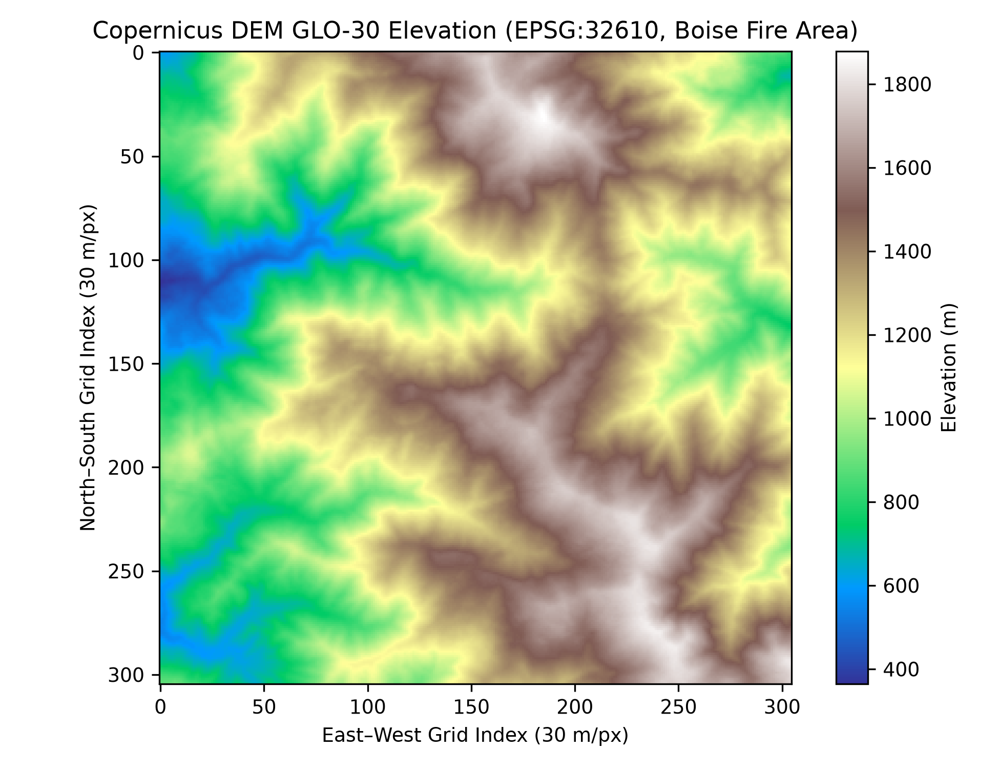 | 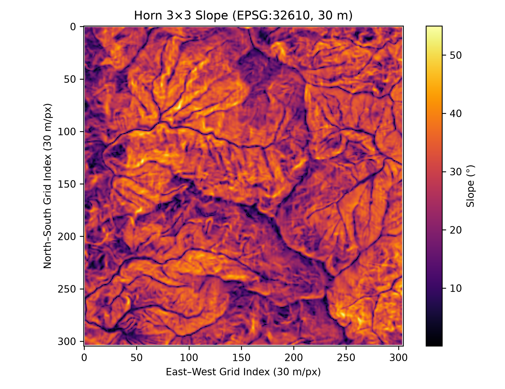 |
| **Downslope Aspect (°)** | **Terrain Ruggedness Index (m)** |
| 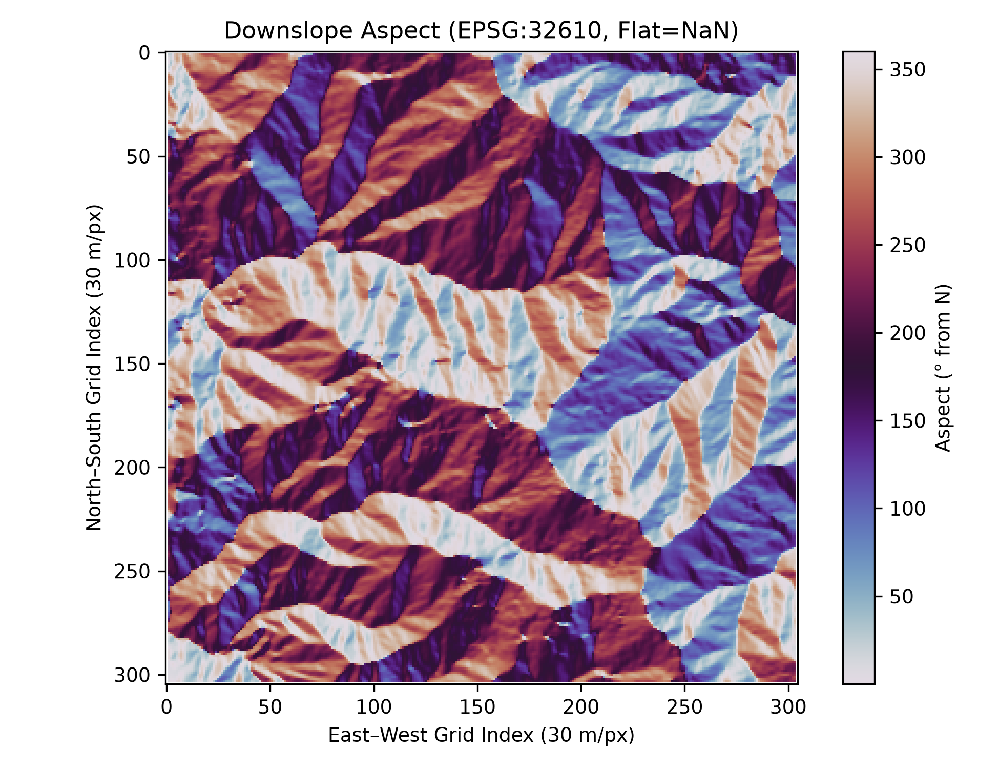 | 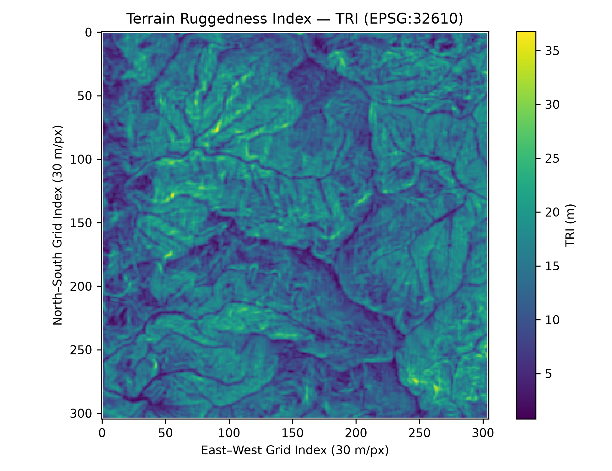 |

---

## Research Study 1 — Terrain–Wildfire Spatial Analysis & Robustness Audit

- **Scope**: Northern California (`[-124.2, 39.5, -121.0, 42.0]`, `EPSG:32610`), **August 1–20, 2024**, **3,294** deduplicated `VIIRS_SNPP_SP` detections across **293** 15 km × 15 km land cells (**19** active, **274** zero-detection).
- **Initial Finding vs. Statistical Audit**: An initial 7-class Kruskal–Wallis test on elevation yielded `H = 16.9609` (`p = 0.0094`, FDR `p = 0.0471`, `ε² = 0.0383`). However, a subsequent statistical integrity audit revealed that **73.8%** of detections were concentrated in **3 cells** (**40.1%** in 1 cell), with significant spatial autocorrelation (`Moran's I = 0.184, p = 0.002` for detections; `I = 0.6425, p = 0.002` for elevation).
- **Conclusion**: The elevation association is **not robustly supported** — it vanishes under presence/absence testing (`Mann–Whitney p = 0.0711`), coarser 4-band binning (`p = 0.3024`), and 30 km spatial block aggregation (`p = 0.3209`).

| Terrain Availability vs. Detections | Elevation Robustness Audit |
| :---: | :---: |
| 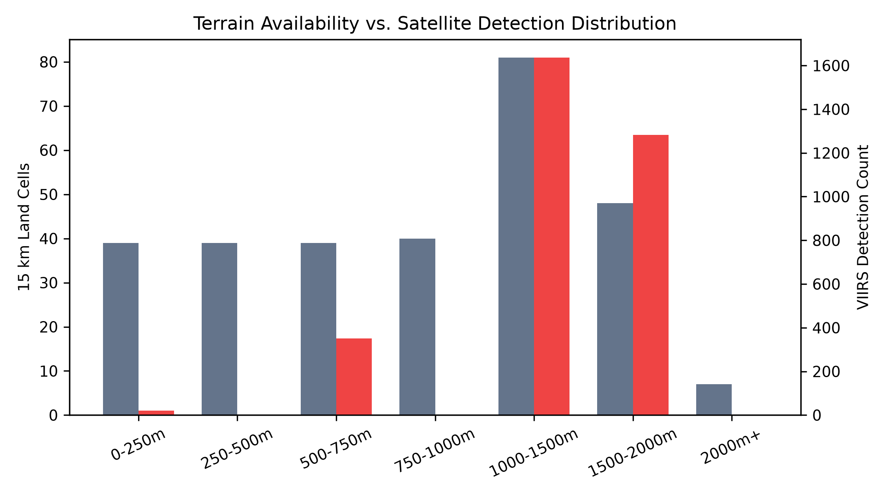 | 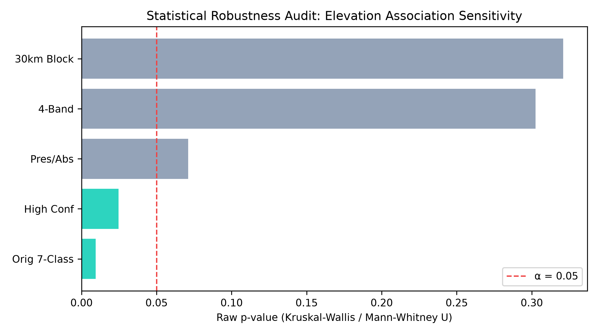 |

---

## Research Study 2 — Wildfire Event Validation (Milestone 4)

Evaluated FlarePoint incidents (`eps = 5.0 km`, `max_temporal_gap = 24.0 h`) against **NIFC WFIGS Interagency Fire Perimeters (2024)** (`4` active fires `>= 10 acres` in Northern California, Aug 1–20, 2024):

| Metric | Value | Definition (Numerator / Denominator) |
| :--- | ---: | :--- |
| **Satellite Detections** | 3,294 | Deduplicated `VIIRS_SNPP_SP` observations |
| **FlarePoint Incidents** | 11 | Spatiotemporal DBSCAN clusters |
| **Active Reference Fires** | 4 | WFIGS 2024 perimeters (`>= 10 acres`) overlapping window |
| **Event Precision** | **72.73%** | `8` matched FlarePoint incidents / `11` total FlarePoint incidents |
| **Event Recall** | **50.00%** | `2` matched reference fires / `4` active reference fires |
| **Event F1** | **59.26%** | Harmonic mean of Precision & Recall |
| **Median / Mean Perimeter Dist** | **0.0 / 1.794 km** | `EPSG:32610` distance from centroid to matched perimeter (`n=8`) |
| **Fragmented Reference Fires** | **2 / 2** | Park Fire (`6` fragments) & Boise Fire (`2` fragments) |
| **Merged Incidents** | **0 / 11** | Zero FlarePoint incidents merged multiple reference fires |

| Event Validation Metrics | Incident Fragmentation |
| :---: | :---: |
| 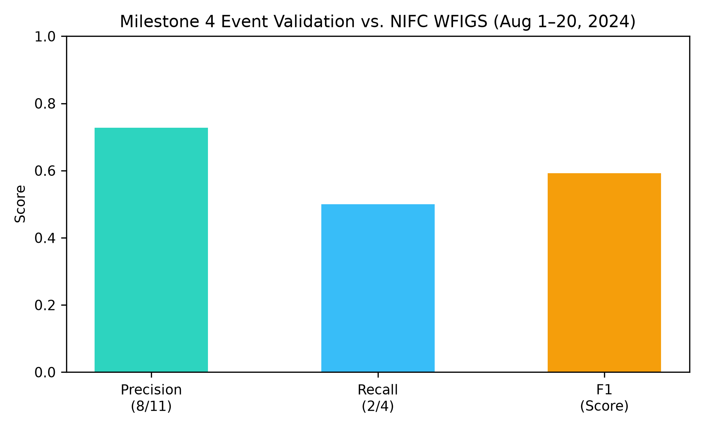 | 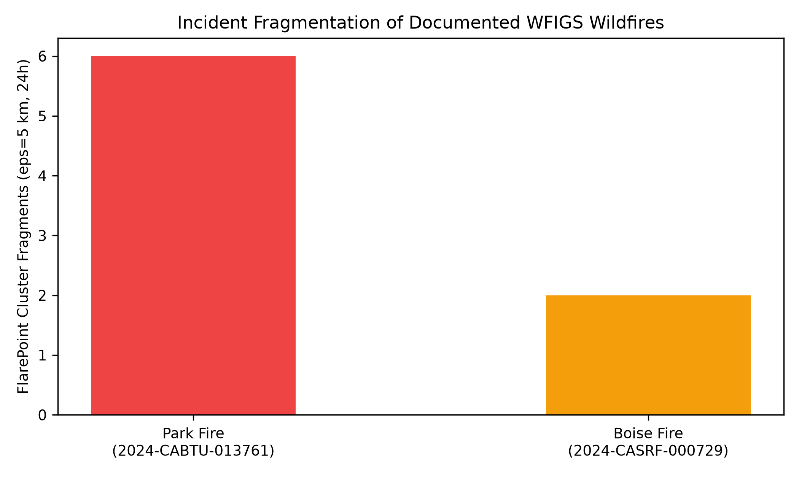 |

---

## Research Study 3 — Incident Continuity Evaluation (Milestone 5)

To address fragmentation without sacrificing merge safeguards, `associate_incidents_to_events()` (`backend/app/analytics/continuity.py`) groups related cluster fragments into underlying `ContinuityEvent` entities (`15 km / 48 h`) while preserving original incident IDs. On the Northern California development set:

| Method | Incidents / Events | Matched | Precision | Recall | F1 | Fragmented Refs | Merged |
| :--- | ---: | ---: | ---: | ---: | ---: | ---: | ---: |
| **Baseline (DBSCAN 5 km / 24 h)** | 11 | 8 | 0.7273 | 0.5000 | 0.5926 | 2 | 0 |
| **Continuity Events (15 km / 48 h)** | 6 | 3 | 0.5000 | 0.5000 | 0.5000 | 1 | 0 |

*Note: Development evaluation on 4 reference fires; grouping 6 Park Fire fragments into 1 event reduced fragmentation by 50% (`2 → 1`) while keeping `merged_fps = 0`, though Precision dropped because 3 unmatched small thermal anomalies remained ungrouped.*

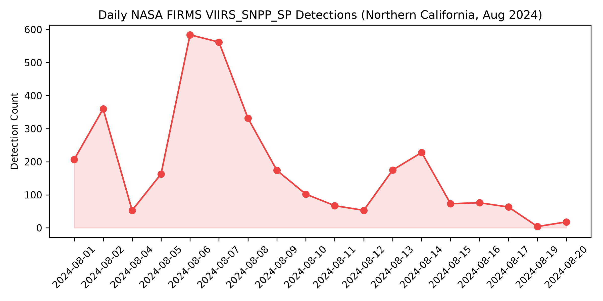

---

## Quick Start

### 1. Docker Compose (Recommended)
```bash
git clone https://github.com/YusufMalu001/FlarePoint.git
cd FlarePoint
cp .env.example .env   # Optionally add NASA_FIRMS_MAP_KEY and set DEMO_MODE=false
docker compose up --build
```
- **Frontend Workstation**: `http://localhost:3000`
- **Backend API Docs**: `http://localhost:8000/docs`

### 2. Local Development & Tests
```bash
# Backend
cd backend
python3 -m venv .venv && .venv/bin/pip install -r requirements.txt
DATABASE_URL="sqlite:///./flarepoint.db" PYTHONPATH=. .venv/bin/alembic upgrade head
PYTHONPATH=. .venv/bin/pytest -v

# Frontend
cd ../frontend
npm install && npm run build
```

### 3. Reproducible Offline Research Commands
```bash
cd backend
PYTHONPATH=. .venv/bin/python experiments/flarepoint_terrain_fire_study/audit/run_audit.py
PYTHONPATH=. .venv/bin/python experiments/flarepoint_event_validation/scripts/run_validation.py
PYTHONPATH=. .venv/bin/python experiments/flarepoint_event_validation/scripts/compare_continuity.py
PYTHONPATH=. .venv/bin/python experiments/final_research/visualizations/generate_figures.py
```

---

## Limitations

- **Satellite Observations ≠ Fire Perimeters**: VIIRS detections are 375 m pixel centers subject to cloud cover, swath gaps, and overpass timing; convex-hull footprints are upper-bound affected areas, not burned areas.
- **Reference Dataset Incompleteness**: NIFC WFIGS perimeters exclude small fires, prescribed burns, and non-wildfire heat sources; unmatched FlarePoint incidents are not confirmed false positives.
- **No Predictive Spread or Risk Model**: Prioritization uses explainable heuristic rules; temporal forecasting models detection activity only and is not a physical fire-spread prediction.
- **Small Validation Sample**: Milestone 4 evaluated 4 active reference fires in a single 20-day Northern California window.

## Future Work
- Multi-year, multi-region validation against WFIGS and CAL FIRE FRAP.
- Satellite overpass / cloud-mask observation opportunity normalization.

## License
No open-source license file is currently included in this repository; all rights are reserved by the repository owner unless a `LICENSE` file is added.
