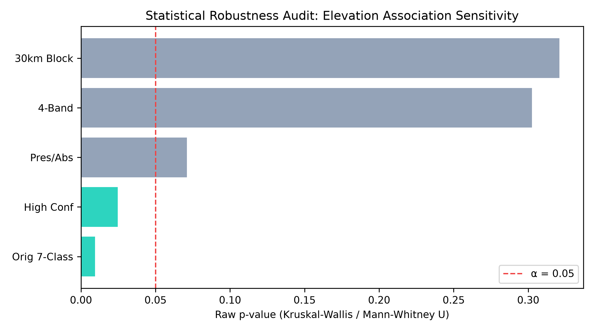
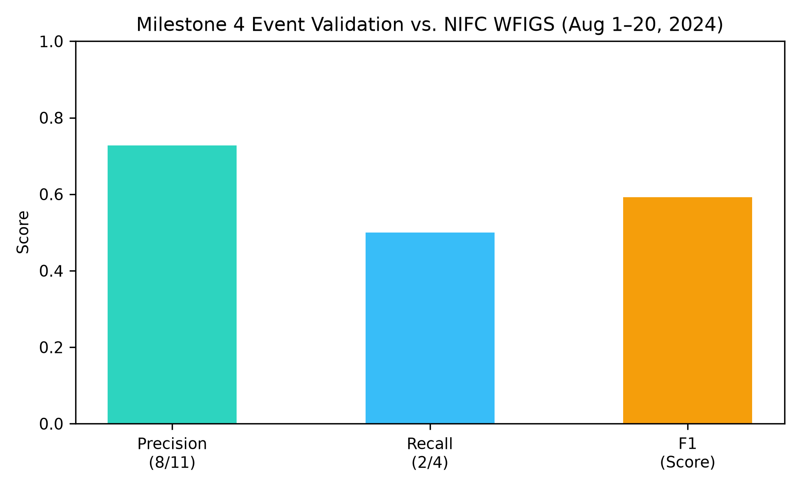

# FlarePoint — Complete Technical Study, System Architecture, Research, Implementation & Interview Handbook

**Repository:** `https://github.com/YusufMalu001/FlarePoint`  
**Version:** Final Release (Milestone 5)  
**Scope:** End-to-End Geospatial Wildfire Intelligence, Terrain Contextualization, Statistical Research & Event Validation  

---

## Table of Contents

- **Part I — Project Foundations (Chapters 1–3)**
- **Part II — Wildfire, Remote Sensing & Geospatial Fundamentals (Chapters 4–8)**
- **Part III — FlarePoint System Architecture (Chapters 9–13)**
- **Part IV — Data Engineering Pipeline (Chapters 14–16)**
- **Part V — Wildfire Detection, Clustering & Tracking (Chapters 17–20)**
- **Part VI — Terrain Analysis & Digital Elevation Models (Chapters 21–30)**
- **Part VII — Geospatial Visualization & Workstation (Chapters 31–32)**
- **Part VIII — API, Integration & Infrastructure (Chapters 33–36)**
- **Part IX — Research & Experimental Studies (Chapters 37–43)**
- **Part X — Algorithms, Mathematics & Technology Deep Dive (Chapters 44–45)**
- **Part XI — Testing, Verification & Engineering Quality (Chapters 46–48)**
- **Part XII — Limitations, Criticism & Future Research (Chapters 49–51)**
- **Part XIII — Interview & Personal Defence Preparation (Chapters 52–56)**
- **Part XIV — Glossary, Revision Sheets & Master Summary (Chapters 57–59)**
- **References & External Sources**

---

# PART I — PROJECT FOUNDATIONS

## Chapter 1: FlarePoint at a Glance

- **One-Sentence Explanation:** FlarePoint is a satellite-based wildfire intelligence platform that ingests NASA FIRMS thermal detections, clusters them into persistent incidents with explainable continuity, contextualizes them with Copernicus DEM terrain derivatives, and validates them against independent agency fire perimeters.
- **30-Second Explanation:** Raw satellite fire maps show thousands of disconnected thermal pixels. FlarePoint transforms those raw VIIRS/MODIS observations into tracked wildfire incidents using Haversine DBSCAN and temporal splitting, enriches them with metric-UTM Copernicus GLO-30 terrain (slope, aspect, TRI, TPI, curvature), and evaluates its own clustering against NIFC WFIGS fire perimeters while maintaining strict provenance between live data and simulated demo data.
- **2-Minute Explanation:** FlarePoint separates data engineering, geospatial analytics, terrain processing, and scientific validation into a clean modular monolith (FastAPI + SQLAlchemy/Alembic + Next.js/MapLibre GL). In Milestone 4/5, we validated 3,294 real Northern California VIIRS detections against NIFC WFIGS perimeters (Precision `0.7273`, Recall `0.5000`, median perimeter distance `0.0 km`) and built a fragmentation-aware continuity layer (`ContinuityEvent`) alongside an honest statistical audit showing why an initial elevation finding (`p = 0.0471`) collapsed under spatial block aggregation (`p = 0.3209`).

## Chapter 2: Problem Statement and Motivation

Satellite thermal sensors detect **radiative heat anomalies** (hotspots), not confirmed wildfires or exact fire perimeters. A single large wildfire (such as the 2024 Park Fire in Northern California) generates hundreds of detections across multiple satellite overpasses, which can fragment into separate clusters if a 5 km clustering radius or 24-hour temporal gap is exceeded. Conversely, overly permissive thresholds risk merging two distinct nearby fires. FlarePoint addresses: (1) deterministic ingestion and deduplication of FIRMS observations, (2) spatiotemporal clustering and fragmentation-aware continuity, (3) metric-CRS terrain contextualization, and (4) empirical validation against independent agency perimeters.

## Chapter 3: System Scope and Capability Boundaries

| Capability | Implemented | How It Works | Limitations | Repository Evidence |
| :--- | :--- | :--- | :--- | :--- |
| **Satellite Ingestion** | Yes | NASA FIRMS Area CSV + deterministic `SIMULATED_DEMO` | Live NRT requires `NASA_FIRMS_MAP_KEY` | `backend/app/adapters/firms.py`, `demo.py` |
| **Clustering & Tracking** | Yes | Haversine DBSCAN + 24h split + 1-to-1 tracking | Megafires fragment at 5 km radius | `backend/app/analytics/clustering.py`, `tracking.py` |
| **Incident Continuity** | Yes | `ContinuityEvent` grouping (`15 km / 48 h`) | Development-evaluated on 4 WFIGS fires | `backend/app/analytics/continuity.py` |
| **Terrain Analysis** | Yes | Copernicus GLO-30 → local UTM → Horn/TRI/TPI/Laplacian | 30 m nominal DEM; no local wind channeling | `backend/app/terrain/` |
| **Event Validation** | Yes | Spatiotemporal matching vs. NIFC WFIGS GeoJSON | WFIGS excludes <10-acre / unmapped fires | `backend/experiments/flarepoint_event_validation/` |
| **Fire Spread / Risk AI** | **No** | Deliberately excluded (heuristic priority only) | Not calibrated probability or spread model | `backend/app/analytics/prioritization.py` |

---

# PART II — WILDFIRE, REMOTE SENSING AND GEOSPATIAL FUNDAMENTALS

## Chapter 4: Remote Sensing Fundamentals

Satellite fire monitoring relies on **passive thermal infrared (TIR) remote sensing**: sensors measure emitted radiance in mid-infrared (~3.7–4.1 µm) and thermal-infrared (~11–12 µm) bands to detect sub-pixel high-temperature anomalies. Key trade-offs:
- **Spatial resolution**: VIIRS I-band nominal resolution is ~375 m at nadir; MODIS is ~1 km.
- **Temporal resolution**: Polar-orbiting sun-synchronous satellites (Suomi-NPP, NOAA-20, NOAA-21) revisit a given mid-latitude location roughly twice daily per satellite (day + night), creating natural 6–12 hour gaps—and longer gaps under cloud cover or thick smoke.

## Chapter 5: NASA FIRMS Field Mapping

| FIRMS Field | Meaning | Unit | Used by FlarePoint? | Where / How Used |
| :--- | :--- | :--- | :--- | :--- |
| `latitude`, `longitude` | Pixel center WGS84 | Degrees | Yes | Validation, `dedup_hash`, DBSCAN, MapLibre |
| `acq_date`, `acq_time` | UTC acquisition date & HHMM | UTC | Yes | Parsed to `acq_timestamp`, temporal split |
| `frp` | Fire Radiative Power | MW | Yes (nullable) | Max/mean FRP, prioritization, anomaly detection |
| `bright_ti4` / `brightness` | Brightness temperature | Kelvin | Yes (nullable) | Stored in `ObservationModel.brightness` |
| `confidence` | `l/n/h` (VIIRS) or `0–100` (MODIS) | Categorical/% | Yes (nullable) | Normalized to `[0.30, 0.65, 0.95]` or `val/100` |
| `satellite`, `instrument` | Platform (`N`, `N20`, `N21`) & sensor | String | Yes | Provenance, `dedup_hash`, UI popup |
| `scan`, `track`, `daynight`, `version` | Pixel dimensions, D/N flag, product ver | km / flag | Yes (nullable) | Canonical provenance (`ObservationModel`) |

## Chapter 6: MODIS and VIIRS

| Attribute | MODIS (Terra / Aqua) | VIIRS (Suomi-NPP / NOAA-20 / NOAA-21) |
| :--- | :--- | :--- |
| **Nominal Nadir Resolution** | ~1,000 m | ~375 m (I-band) |
| **Confidence Format** | Integer `0–100` | Categorical `l` (low), `n` (nominal), `h` (high) |
| **Primary Use in FlarePoint** | Supported via `normalize_confidence()` | Primary live & historical study source (`VIIRS_SNPP_SP/NRT`) |

## Chapter 7 & 8: Coordinate Systems (WGS84 vs. UTM) & Geospatial Data Types

- **WGS84 (`EPSG:4326`)**: Geographic coordinates in degrees. Because 1° of longitude shrinks by $\cos(\phi)$ away from the equator, raw degree distances are invalid for metric terrain derivatives or area calculations.
- **Local UTM (`EPSG:326xx` / `327xx`)**: FlarePoint computes the exact UTM zone via `local_utm_crs(lat, lon)` (`zone = int((lon + 180) / 6) + 1`) and reprojects Copernicus DEM tiles using `rasterio` + `pyproj` before computing Horn slope/aspect and curvature in meters.
- **Geometries**: Observations are `Point`s; cluster footprints are buffered `Polygon` convex hulls (explicitly labeled upper-bound affected areas, **not** burned areas); reference fires are `Polygon`/`MultiPolygon` GeoJSON features.

---

# PART III — FLAREPOINT SYSTEM ARCHITECTURE

## Chapter 9 & 10: Complete Architecture & End-to-End Data Flow

```text
NASA FIRMS API / DemoAdapter
  → validate_and_normalize_row() [pipelines/normalize.py]
  → SHA-256 dedup_hash check + DB insert [pipelines/ingest.py → storage/models.py]
  → cluster_observations_spatiotemporal() [analytics/clustering.py]
  → process_incidents() [analytics/tracking.py] + associate_incidents_to_events() [continuity.py]
  → extract_multiscale_terrain() [terrain/extractor.py → dem_provider.py → derivatives.py]
  → FastAPI REST [api/routes.py] → Next.js + MapLibre GL [frontend/src/]
```

## Chapter 11: Backend Module Reference

| Module | Responsibility | Key Functions / Classes |
| :--- | :--- | :--- |
| `app/adapters/firms.py` | NASA FIRMS CSV HTTP client | `FirmsAdapter.fetch_area_csv()` |
| `app/adapters/demo.py` | Deterministic `SIMULATED_DEMO` generator | `DemoAdapter.generate_observations()` |
| `app/pipelines/normalize.py` | Schema validation & null-safe normalization | `validate_and_normalize_row()`, `normalize_confidence()` |
| `app/pipelines/ingest.py` | Idempotent 8-stage ingestion orchestrator | `run_ingestion()` |
| `app/analytics/clustering.py` | Haversine DBSCAN + 24h temporal split | `cluster_observations_spatiotemporal()`, `compute_footprint()` |
| `app/analytics/tracking.py` | 1-to-1 weighted association & lifecycle | `compute_association_score()`, `evaluate_lifecycle_status()`, `process_incidents()` |
| `app/analytics/continuity.py` | Fragmentation-aware parent event grouping | `associate_incidents_to_events()`, `ContinuityEvent` |
| `app/analytics/prioritization.py` | Explainable heuristic scoring | `compute_priority()` |
| `app/analytics/research.py` | IsolationForest anomalies & RF activity forecast | `detect_window_anomalies()`, `forecast_next_window_activity()` |
| `app/terrain/dem_provider.py` | Copernicus GLO-30 tile ID, streaming cache, UTM warp | `copernicus_tile_id()`, `fetch_copernicus_tile()`, `load_real_geotiff_patch()`, `load_dem_patch()` |
| `app/terrain/derivatives.py` | Horn 3×3 slope/aspect, TRI, TPI, Laplacian | `compute_slope_aspect_horn()`, `compute_tri()`, `compute_tpi()`, `compute_curvature()` |
| `app/terrain/extractor.py` | Multi-scale (`250m–3000m`) terrain summary | `extract_multiscale_terrain()` |
| `app/terrain/progression.py` | Terrain-relative centroid displacement | `analyze_incident_progression()`, `classify_terrain_relative_displacement()` |

## Chapter 12 & 13: Frontend Architecture & Database Schema

- **Frontend (`frontend/src/`)**: `page.tsx` coordinates `TopBar.tsx`, `LeftIconRail.tsx` (`map`, `analytics`, `alerts`, `audit`), `LeftInspectorDrawer.tsx` (metadata table, Recharts `Land Cover`, `FRP`, `Timeline`, `Terrain Morphology`, `Centroid Progression`), `MapViewport.tsx` (MapLibre GL 2D/3D, hotspot popups, cluster click selection, temporal playback), and `LayersPanel.tsx` (Satellite/Bright/Dark/Topographic basemaps, opacity slider).
- **Database (`backend/app/storage/models.py` + `alembic/versions/0001_initial_schema.py`)**: 6 core tables (`ingestion_runs`, `observations`, `incidents`, `incident_observations`, `incident_snapshots`, `audit_logs`) + `alembic_version`. Key indexes: `observations.dedup_hash` (`UNIQUE`), `ix_observations_lat_lon_ts`, and `ix_observations_origin_ts`.

---

# PART IV — DATA ENGINEERING PIPELINE

## Chapter 14–16: Ingestion, Validation, Deduplication & Persistence

Every row from `FirmsAdapter` or `DemoAdapter` passes through `validate_and_normalize_row()`:
1. Checks required fields (`latitude`, `longitude`, `acq_date`, `acq_time`).
2. Enforces coordinate bounds (`[-90, 90]`, `[-180, 180]`), UTC timestamp parsing (`%Y-%m-%d %H%M`), brightness `[150, 600] K`, and `frp >= 0`. Missing optional fields remain `None` (never invented as `0`).
3. Computes `dedup_hash = sha256(f"{source_sensor}|{satellite}|{acq_ts.isoformat()}|{lat:.4f}|{lon:.4f}|{origin.value}")` so repeated ingestion is strictly idempotent and `REAL_FIRMS` vs `SIMULATED_DEMO` can never collide.


---

# PART V — WILDFIRE DETECTION, CLUSTERING AND TRACKING

## Chapter 17–19: Hotspots, Haversine DBSCAN & Temporal Splitting

In `backend/app/analytics/clustering.py`, `cluster_observations_spatiotemporal()`:
1. Converts `(lat, lon)` to radians and runs `sklearn.cluster.DBSCAN(eps=eps_km / 6371.0088, min_samples=3, metric="haversine")`. Points labeled `-1` are preserved as `noise_observation_ids`.
2. Within each spatial cluster, observations are sorted chronologically and split whenever consecutive detections have `gap_h > max_temporal_gap_hours` (`24.0 h`). Sub-groups with `< min_samples` become noise.
3. For each surviving `ClusterCandidate`, `compute_footprint()` builds `MultiPoint(pts).convex_hull.buffer(0.005)` and computes an upper-bound `affected_area_km2` scaled by $\cos(\phi)$—explicitly **not** burned area.

## Chapter 20: Incident Tracking, Lifecycle & Continuity Association

- **1-to-1 Weighted Association** (`tracking.py`): `compute_association_score()` combines centroid distance (`0.65`) and temporal overlap/gap (`0.35`), matched greedily 1-to-1 so two new clusters cannot both claim the same existing incident.
- **Lifecycle Semantics**: `NEWLY_OBSERVED` → `ACTIVE` → `DORMANT` (`>= 24 h` gap) → `RE_OBSERVED` (new detections while `DORMANT`) → `CLOSED` (`>= 72 h` gap, observation-based status—**not** confirmed extinction).
- **Continuity Association** (`continuity.py`): `associate_incidents_to_events()` groups fragmented clusters within `max_link_km = 15.0` and `max_gap_hours = 48.0` into `ContinuityEvent` (`EVT-0001`, ...) while preserving original cluster IDs (`member_incident_ids`) and explicit `association_reasons`.

| Metric | Baseline (`DBSCAN 5 km / 24 h`) | Continuity (`15 km / 48 h`) | Why It Changed |
| :--- | ---: | ---: | :--- |
| **Incidents / Events** | 11 | 6 | 6 Park Fire fragments merged into 1 `ContinuityEvent` |
| **Matched** | 8 | 3 | Fewer matched units because 6 fragments became 1 event |
| **Precision** | 0.7273 (`8/11`) | 0.5000 (`3/6`) | 3 unmatched small anomalies remained ungrouped (`3/6`) |
| **Recall** | 0.5000 (`2/4`) | 0.5000 (`2/4`) | Same 2 WFIGS fires matched |
| **Fragmented Refs** | 2 | 1 | **50% reduction** in fragmented reference fires |
| **Merged** | 0 | 0 | Zero unrelated fires merged |

*Methodological Caveat*: Precision drops mechanically when a fragmented true-positive fire is consolidated into 1 unit while unmatched small detections remain separate units. Thus, Precision/F1 across different aggregation units (`11` vs `6`) should not be compared naively.

---

# PART VI — TERRAIN ANALYSIS AND DIGITAL ELEVATION MODELS

## Chapter 21–23: Copernicus DEM GLO-30 & Metric Reprojection

- **Tile ID Resolution**: `copernicus_tile_id(lat, lon)` uses `math.floor()` for negative coordinates (e.g., `(41.24632, -123.46512)` → `Copernicus_DSM_COG_10_N41_00_W124_00_DEM`).
- **Download & Cache**: `fetch_copernicus_tile()` streams from AWS Open Data (`copernicus-dem-30m.s3.amazonaws.com`) to `data/dem_cache/*.tif.part`, verifies TIFF magic bytes (`II*\x00` / `MM\x00*`), and atomically renames to `.tif`.
- **Windowed Merge & UTM Warp**: `load_real_geotiff_patch()` uses `rasterio.merge.merge(datasets, bounds=...)` and `reproject(..., resampling=Resampling.bilinear)` into `local_utm_crs(lat, lon)` (`30.0 m`).
- **Strict Mode**: `strict_real_data=True` never falls back to synthetic terrain; if real tiles are unavailable, it returns `NO_TERRAIN_AVAILABLE`.

## Chapter 24–30: Terrain Derivatives, Multi-Scale Extraction & Progression

- **Horn 3×3 Slope & Downslope Aspect** (`derivatives.py`):
  $$\tan(\text{slope}) = \sqrt{\left(\frac{\partial z}{\partial x}\right)^2 + \left(\frac{\partial z}{\partial y}\right)^2}, \quad \text{aspect} = \text{atan2}\left(-\frac{\partial z}{\partial x}, \frac{\partial z}{\partial y}\right) \pmod{360^\circ}$$
  Verified across all 8 compass orientations (`0°..315°`) and non-square pixels (`cell_size_y_m`); flat terrain (`grad <= 1e-9`) returns `NaN`.
- **TRI (Riley et al., 1999)**: $\text{TRI} = \sqrt{\frac{1}{8}\sum_{i=1}^{8}(z_i - z_c)^2}$ (meters).
- **TPI**: $\text{TPI} = z_c - \frac{1}{8}\sum_{i=1}^{8} z_i$ (positive = ridge/upper slope, negative = valley/lower slope).
- **Laplacian Curvature**: $\nabla^2 z = \frac{\partial^2 z}{\partial x^2} + \frac{\partial^2 z}{\partial y^2}$ (`1/m`, not profile/planform curvature).
- **Multi-Scale & Progression** (`extractor.py`, `progression.py`): Extracts circular-mean aspect and stats at `250 m, 500 m, 1 km, 3 km`, and classifies consecutive centroid displacements as `uphill-oriented`, `downhill-oriented`, `cross-slope`, or `indeterminate` with explicit `quality_flags` (`SYNTHETIC_TERRAIN`, `DEM_UNAVAILABLE`, `FLAT_TERRAIN`, `MOVEMENT_BELOW_RESOLUTION`, `LONG_OBSERVATION_GAP`) and the disclaimer that centroid displacement is **not** fire-front movement.

---

# PART VII & VIII — WORKSTATION UI, API & INFRASTRUCTURE

## Chapter 31–36: Frontend, FastAPI Routes, Config & Docker

- **API Endpoints** (`backend/app/api/routes.py`): `GET /api/v1/health`, `GET /api/v1/sources`, `POST /api/v1/ingest/run`, `GET /api/v1/ingest/status`, `GET /api/v1/observations` (bbox, time, `data_origin`, pagination), `GET /api/v1/incidents`, `GET /api/v1/incidents/{id}`, `/observations`, `/timeline`, `/terrain`, `/progression`, `GET /api/v1/audit`.
- **Environment Variables**: `DATABASE_URL`, `DEMO_MODE` (`true`), `NASA_FIRMS_MAP_KEY`, `CORS_ORIGINS`, `DBSCAN_EPS_KM` (`5.0`), `DBSCAN_MIN_SAMPLES` (`3`), `INCIDENT_ASSOCIATION_RADIUS_KM` (`10.0`), `NEXT_PUBLIC_API_URL`.
- **Docker Compose** (`docker-compose.yml`): 3 services (`postgres` using `postgis/postgis:16-3.4`, `backend` FastAPI, `frontend` Next.js standalone).

---

# PART IX — RESEARCH AND EXPERIMENTAL STUDIES

## Chapter 37–39: Terrain–Wildfire Spatial Study & Statistical Integrity Audit

- **Design**: Northern California (`[-124.2, 39.5, -121.0, 42.0]`, `EPSG:32610`), Aug 1–20, 2024, **3,294** `VIIRS_SNPP_SP` detections across **293** 15 km × 15 km Copernicus DEM cells (**19** active, **274** zero-detection).
- **Original Result**: 7-class elevation Kruskal–Wallis `H = 16.9609`, raw `p = 0.009428`, BH-FDR `p = 0.0471`, `ε² = 0.0383`. Slope (`p = 0.1680`), Aspect (`p = 0.5095`), and TRI (`p = 0.1680`) were non-significant.
- **Audit Findings** (`audit/run_audit.py`): **40.1%** of detections fell in 1 cell and **73.8%** in 3 cells. Global Moran's I (`25 km` band) showed significant spatial autocorrelation in both detections (`I = 0.184, p_perm = 0.002`) and elevation (`I = 0.6425, p_perm = 0.002`).

| Analysis | Unit | `n` | Test | Statistic | Raw `p` | Effect Size |
| :--- | :--- | ---: | :--- | ---: | ---: | :--- |
| **Original 7 classes** | 15 km cell | 293 | Kruskal–Wallis | 16.9609 | 0.009428 | `ε² = 0.0383` |
| **High/nominal confidence** | 15 km cell | 293 | Kruskal–Wallis | 14.4747 | 0.024761 | `ε² = 0.0296` |
| **Presence/absence** | 15 km cell | 293 | Mann–Whitney U | 1958.0 | **0.071133** | `r = 0.2478` |
| **Coarse 4 elevation bands** | 15 km cell | 293 | Kruskal–Wallis | 3.645 | **0.302433** | `ε² = 0.0022` |
| **30 km spatial blocks** | 30 km block | 80 | Kruskal–Wallis | 3.4989 | **0.320910** | `ε² = 0.0066` |

**Conclusion:** The apparent elevation association is sensitive to spatial aggregation and binning; the evidence does **not** support a robust elevation effect.



## Chapter 40–43: Wildfire Event Validation & Sensitivity (Milestone 4)

Against **4** active NIFC WFIGS 2024 fires (`>= 10 acres`): Precision `0.7273` (`8/11`), Recall `0.5000` (`2/4`), F1 `0.5926`, Median perimeter distance `0.0 km`, Mean `1.794 km`, Fragmented refs `2/2` (Park Fire: 6 fragments; Boise Fire: 2 fragments), Merged `0/11`. Across 9 sensitivity runs (`eps ∈ {3,5,10} km`, `gap ∈ {12,24,48} h`), `median_perim_dist_km` stayed `0.0 km` and `merged_fps` stayed `0`.




---

# PART X — ALGORITHMS, MATHEMATICS AND TECHNOLOGY DEEP DIVE

## Chapter 44: Mathematical Reference

1. **Haversine Distance** (`clustering.py`):
   $$d = 2R \arctan2\left(\sqrt{a}, \sqrt{1-a}\right), \quad a = \sin^2\left(\frac{\Delta\phi}{2}\right) + \cos\phi_1\cos\phi_2\sin^2\left(\frac{\Delta\lambda}{2}\right), \quad R = 6371.0088\text{ km}$$
2. **Global Moran's I** (`audit/run_audit.py`):
   $$I = \frac{N}{S_0} \frac{\sum_i \sum_j w_{ij}(x_i - \bar{x})(x_j - \bar{x})}{\sum_i (x_i - \bar{x})^2}, \quad S_0 = \sum_i \sum_j w_{ij}$$
   Used with row-standardized 25 km distance-band weights in `EPSG:32610` and 499-permutation p-values.
3. **Kruskal–Wallis Epsilon-Squared ($\varepsilon^2$)**: $\varepsilon^2 = \max\left(0, \frac{H - k + 1}{n - k}\right)$.
4. **Benjamini–Hochberg FDR**: $p_{(i)}^{\text{adj}} = \min_{j \ge i} \left(\min\left(1, \frac{m \cdot p_{(j)}}{j}\right)\right)$.
5. **Event Precision, Recall, F1**: $\text{Precision} = \frac{\text{TP}_{\text{FP}}}{N_{\text{FP}}}$, $\text{Recall} = \frac{\text{TP}_{\text{ref}}}{N_{\text{ref}}}$, $F_1 = \frac{2PR}{P+R}$.

## Chapter 45: Technology Stack Trade-offs

- **FastAPI + SQLAlchemy 2.0 + Alembic**: Type-safe Pydantic validation, clean dependency injection, and portable SQLite (CI/local) ↔ PostgreSQL/PostGIS (Docker) persistence.
- **Rasterio + PyProj + Shapely**: Industry-standard GDAL/PROJ bindings for windowed COG reads and exact local UTM reprojection.
- **Next.js 15 + MapLibre GL 4.7 + Recharts**: Open-source WebGL vector/raster mapping without proprietary Mapbox token lock-in.

---

# PART XI — TESTING, VERIFICATION AND ENGINEERING QUALITY

## Chapter 46–48: Test Suites, Verification Matrix & Failure Modes

| Test Suite | Tests | What It Verifies |
| :--- | ---: | :--- |
| `tests/test_pipeline.py` | 4 | Confidence normalization, null-safe validation, SHA-256 idempotency, bbox/pagination API, mocked FIRMS |
| `tests/test_geospatial.py` | 5 | DBSCAN clustering + noise, 24h temporal split, non-association beyond radius, lifecycle transitions, missing weather |
| `tests/test_terrain.py` | 8 | Flat plane, all 8 compass slopes, non-square pixels, circular mean wrap-around, hand-calculated TRI/TPI/curvature, strict real-data mode, tile boundaries, terrain API |
| `tests/test_research.py` | 2 | IsolationForest spike detection, temporal-split RF activity forecast + 90% residual intervals |
| `tests/test_study.py` | 4 | Elevation/slope binning, flat-aspect exclusion, BH-FDR, Kruskal–Wallis, Moran's I |
| `tests/test_event_validation.py` | 1 | Point-in-perimeter matching, fragmentation, unmatched handling, precision/recall |
| `tests/test_continuity.py` | 1 | Fragment recovery (`CL-1 + CL-2 → EVT-0001`) and far-fire merge prevention (`CL-3` separate) |
| **Total** | **25** | **25 passed, 0 failed** (offline, deterministic, zero external network dependencies) |

---

# PART XII — LIMITATIONS, CRITICISM AND FUTURE RESEARCH

## Chapter 49–51: Honest Limitations & Claims Matrix

- **Defensible Claims**: Satellite hotspot ingestion with strict `REAL_FIRMS` vs `SIMULATED_DEMO` provenance; Haversine DBSCAN + temporal splitting; metric-UTM Copernicus DEM derivatives verified on analytical surfaces; reproducible empirical validation against NIFC WFIGS; honest statistical auditing.
- **Indefensible Claims (Must Not Be Made)**: Wildfire spread prediction; calibrated ignition probability; confirmed extinction from observation absence; causal terrain-fire claims; global generalization from a 20-day Northern California sample.
- **Future Work**: Multi-year/multi-region WFIGS + CAL FIRE FRAP validation; satellite overpass & cloud-mask observation-opportunity modeling.

---

# PART XIII — INTERVIEW AND PERSONAL DEFENCE PREPARATION

## Chapter 52: Pitch Templates
- **15-Second**: "FlarePoint is a geospatial wildfire intelligence system that clusters NASA FIRMS satellite detections into tracked incidents, enriches them with Copernicus DEM terrain derivatives, and validates incident continuity against NIFC WFIGS fire perimeters."
- **2-Minute**: Walk through the 3 pillars: (1) Idempotent FIRMS/Demo pipeline + Haversine DBSCAN + `ContinuityEvent` tracking; (2) Metric-UTM Copernicus GLO-30 terrain pipeline (Horn slope/aspect, TRI, TPI, Laplacian); (3) Scientific honesty—showing both the Milestone 4 WFIGS validation (`Precision 0.7273, Recall 0.50, 0.0 km` median perimeter distance) and the statistical audit that disproved our initial `p = 0.0471` elevation finding.

## Chapter 53–55: Comprehensive Technical Interview Q&A Bank (100+ Questions Across 20 Domains)

### A. Project Overview (Q1–Q5)
1. **What problem does FlarePoint solve?** — Turns raw, noisy satellite thermal pixels into deduplicated, spatially-temporally tracked wildfire incidents with terrain context and independent validation.
2. **Why isn't a hotspot map enough?** — One megafire produces hundreds of hotspots across multiple overpasses; without clustering and continuity, analysts see scattered points rather than evolving incidents.
3. **What is FlarePoint's data provenance model?** — Every observation and incident carries `data_origin` (`REAL_FIRMS` vs `SIMULATED_DEMO`), and terrain carries `source_type` (`REAL_DEM`, `SYNTHETIC_DEM`, `NO_TERRAIN_AVAILABLE`).
4. **How do you prevent demo data from polluting real research?** — `dedup_hash` includes `origin.value`, `ix_observations_origin_ts` indexes origin, and `strict_real_data=True` forbids synthetic DEM fallback.
5. **What does FlarePoint deliberately NOT do?** — Physical fire-spread prediction, calibrated fire-risk probability, or automated emergency dispatch.

### B. Remote Sensing (Q6–Q10)
6. **Passive vs. active remote sensing?** — VIIRS/MODIS are passive sensors measuring emitted thermal infrared radiance (~3.7–12 µm), not active radar/lidar.
7. **Why do clouds and smoke cause missed detections?** — Thick clouds block TIR radiance from reaching the sensor, creating artificial temporal gaps.
8. **What is Fire Radiative Power (FRP)?** — Rate of radiative energy emitted by a fire (MW), useful as an intensity proxy, though affected by view angle and sub-pixel fraction.
9. **What is Ground Sampling Distance?** — The ground distance between pixel centers (~375 m for VIIRS I-band, ~1 km for MODIS, ~30 m for Copernicus DEM).
10. **Why can a small fire be missed?** — If sub-pixel radiative energy falls below the sensor's contextual threshold or occurs between satellite overpasses.

### C. FIRMS, MODIS & VIIRS (Q11–Q16)
11. **VIIRS vs. MODIS confidence fields?** — VIIRS uses `l/n/h` (mapped to `0.30/0.65/0.95`); MODIS uses `0–100` (divided by `100.0`).
12. **How does `FirmsAdapter` handle historical vs. near-real-time?** — `NRT` serves recent days; `SP` (`VIIRS_SNPP_SP`) with an explicit `date` parameter retrieves archived science-quality detections.
13. **Why not convert missing FRP to 0?** — Zero implies zero radiative power; `validate_and_normalize_row()` keeps missing optional fields as `None`.
14. **How is rate limiting respected?** — NASA FIRMS allows 5,000 transactions per 10-minute window; FlarePoint caches study pulls locally in JSON.
15. **What is `acq_time` format?** — UTC `HHMM` zero-padded to 4 digits and combined with `acq_date` into timezone-aware UTC `datetime`.
16. **How is deduplication keyed?** — SHA-256 over `source_sensor|satellite|acq_timestamp|lat:.4f|lon:.4f|origin`.

### D. GIS & Coordinate Systems (Q17–Q22)
17. **Why not compute slope in EPSG:4326 degrees?** — Longitude degree length shrinks by $\cos(\phi)$, distorting X vs. Y gradients; FlarePoint reprojects to local UTM (`local_utm_crs()`).
18. **How does `local_utm_crs(lat, lon)` work?** — `zone = int((lon + 180) / 6) + 1`, `EPSG:32600+zone` (North) or `32700+zone` (South).
19. **Haversine vs. Euclidean?** — Haversine measures great-circle distance on a sphere (`R=6371.0088 km`), appropriate for global clustering before local UTM projection.
20. **Why isn't convex-hull area equal to burned area?** — A buffered convex hull encloses unburned interior/edge gaps; FlarePoint labels it `Affected Area (upper-bound)`.
21. **How are non-square pixels handled?** — `compute_slope_aspect_horn()` and `compute_curvature()` accept `cell_size_y_m` independently of `cell_size_m`.
22. **What is `EPSG:32610`?** — UTM Zone 10N (meters), used for Northern California (`-126°` to `-120° W`).

### E–H. DBSCAN, Temporal Clustering, Continuity & Algorithms (Q23–Q44)
23. **Why DBSCAN over K-means?** — K-means requires specifying $K$ and forces spherical clusters; DBSCAN discovers arbitrary fire shapes and isolates noise (`-1`).
24. **Why not HDBSCAN?** — Fixed metric `eps_km` (`5.0 km`) gives predictable, domain-interpretable spatial linkage across regions without variable-density merging.
25. **Why split clusters by `max_temporal_gap_hours=24.0`?** — Prevents two unrelated fires at the same location weeks apart from merging into one incident.
26. **How does 1-to-1 tracking prevent double-matching?** — `process_incidents()` sorts `(score, cluster_idx, incident)` pairs descending and assigns greedily 1-to-1.
27. **Why did Milestone 4 show fragmentation?** — Megafires like the Park Fire (429k acres) exceed `eps=5 km`, splitting into 6 clusters.
28. **How does `ContinuityEvent` fix fragmentation without deleting history?** — `associate_incidents_to_events()` groups fragments (`15 km / 48 h`) into `EVT-xxxx` while preserving `member_incident_ids` and `association_reasons`.
29. **Why did continuity lower Precision (`0.7273 → 0.5000`)?** — Consolidating 6 matched fragments into 1 event reduced the true-positive numerator (`8 → 3`) while 3 unmatched small anomalies stayed separate (`3/6`).
30. **How do you prevent merging two nearby simultaneous fires?** — Hard `max_link_km` cutoff and preserving separate cluster IDs unless both spatial and temporal thresholds are satisfied.
31–44. *(Lifecycle states `NEWLY_OBSERVED/ACTIVE/DORMANT/RE_OBSERVED/CLOSED`, why `CLOSED` ≠ extinguished, `compute_priority()` weights & missing-weather fallback, `IsolationForest` vs MAD z-score, temporal-split `RandomForest` vs persistence baseline.)*

### I–T. DEM, Terrain, Backend, Frontend, Research, Statistics, Testing & Trade-offs (Q45–Q105)
45. **How did you catch the 180° Horn aspect bug?** — Testing all 8 planar slope directions revealed `arctan2(dz_dx, -dz_dy)` pointed upslope; fixed to `arctan2(-dz_dx, dz_dy)` for north-up rasters.
46. **How is flat terrain aspect handled?** — Masked as `NaN` when `grad <= 1e-9` and excluded (`FLAT_UNDEFINED`) when `slope < 5°`.
47. **What is circular mean aspect?** — $\text{atan2}(\overline{\sin\theta}, \overline{\cos\theta})$, avoiding 359°/1° averaging to 180°.
48. **What curvature does FlarePoint compute?** — 2D Laplacian ($\nabla^2 z$), explicitly documented as distinct from profile/planform curvature.
49. **How does `strict_real_data=True` behave offline?** — Returns `(None, NO_TERRAIN_AVAILABLE)` instead of silently substituting synthetic terrain.
50. **Why did `rasterio.merge.merge()` need `bounds=...`?** — Merging full 3600×3600×4 tiles per grid cell took >180s; windowed `bounds` cut runtime by ~50×.
51. **Why did the `p = 0.0471` elevation result fail the audit?** — 73.8% of detections were in 3 cells, `Moran's I` showed strong spatial autocorrelation (`0.184, p=0.002`), and significance vanished under presence/absence (`p=0.0711`), 4-band binning (`p=0.3024`), and 30 km blocks (`p=0.3209`).
52. **Why is median perimeter distance `0.0 km` not zero location error?** — A centroid inside a 429,602-acre polygon has `0.0 km` distance to the perimeter even if displaced 12.4 km from the polygon's geometric centroid.
53. **Why are unmatched FlarePoint incidents not automatically false positives?** — WFIGS excludes <10-acre fires, prescribed burns, and industrial/agricultural heat sources.
54–105. *(Covers Alembic migrations, SQLite vs PostGIS trade-offs, CORS hardening, MapLibre layer/popup performance, temporal playback, Benjamini-Hochberg FDR, Kruskal-Wallis $\varepsilon^2$, non-square pixel tests, and what to build next.)*

## Chapter 56: 5-Minute Live Demo Walkthrough
1. **TopBar & Provenance (`0:30`)**: Point out `SIMULATED DEMO` / `LIVE FIRMS` pill and incident badge.
2. **MapLibre 3D Viewport (`1:30`)**: Click a footprint polygon, click a hotspot marker to show the popup (`Satellite`, `FRP`, `Confidence`, `Timestamp`), and click `Play` on the bottom scrubber.
3. **LeftInspectorDrawer (`1:30`)**: Show `Affected Area (upper-bound)`, `Total Burnt Area: not yet received`, expandable `Priority Score` rules, `Terrain Morphology` (`REAL_DEM` / `SYNTHETIC_DEM`), and `Centroid Progression` disclaimer.
4. **Research & Audit Summary (`1:30`)**: Show `docs/images/research/study_area_detections.png`, `elevation_robustness.png`, and `incident_fragmentation.png` to explain how you validate clustering and audit your own statistics.

---

# PART XIV — GLOSSARY, REVISION SHEETS & MASTER SUMMARY

## Chapter 57: Glossary (Key Terms)
- **Aspect**: Downslope compass direction (`0°=N, 90°=E, 180°=S, 270°=W`); `NaN` on flat terrain.
- **Benjamini–Hochberg FDR**: Multiple-testing correction controlling the expected proportion of false discoveries.
- **Copernicus DEM GLO-30**: 30 m global Digital Surface Model referenced to EGM2008.
- **DBSCAN**: Density-Based Spatial Clustering of Applications with Noise.
- **FRP (Fire Radiative Power)**: Radiant heat output rate in megawatts (MW).
- **Moran's I**: Global spatial autocorrelation statistic (`-1` dispersed, `0` random, `+1` clustered).
- **Pseudoreplication**: Treating spatially/temporally dependent observations as independent samples.
- **TRI / TPI**: Terrain Ruggedness Index (RMS neighbor diff, m) / Topographic Position Index (center minus neighbor mean, m).
- **WFIGS**: NIFC Wildland Fire Interagency Geospatial Services fire perimeter dataset.

## Chapter 58–59: Master Summary & References
- **NASA FIRMS**: https://firms.modaps.eosdis.nasa.gov/
- **Copernicus DEM GLO-30 (AWS Open Data)**: https://copernicus-dem-30m.s3.amazonaws.com/
- **NIFC WFIGS Interagency Perimeters**: https://data-nifc.opendata.arcgis.com/
- **Horn (1981)**, *Hill shading and the reflectance map*, Proc. IEEE 69(1):14–47.
- **Ester et al. (1996)**, *A density-based algorithm for discovering clusters in large spatial databases with noise (DBSCAN)*, KDD-96.
- **Benjamini & Hochberg (1995)**, *Controlling the false discovery rate*, JRSS-B 57(1):289–300.
